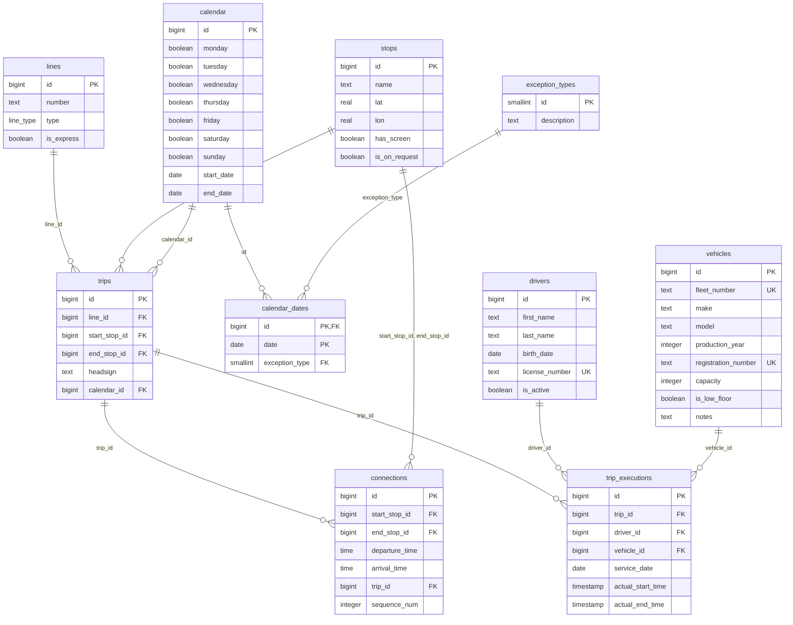

# Bazy danych raport 3

Baza danych komunikacji miejskiej - implementacja i dane przykładowe

Michał Puchyr 272733 · Dawid Łebkowski 266596 · Jędrzej Lower 263628

25.10.2026

## Wybór i instalacja DBMS

Wybraliśmy PostgreSQL 17, uruchamiany w kontenerze Docker. Zalecanego Oracle Database 21c XE nie użyliśmy z trzech powodów:

- Oracle 21c XE nie ma natywnej wersji dla procesorów ARM (Apple Silicon), na których pracuje część zespołu. Wymagałby emulacji x86.
- Edycja XE ma limity: 2 wątki CPU, 2 GB pamięci i 12 GB danych użytkownika.
- PostgreSQL ma polecenie `COPY` do szybkiego ładowania dużych zbiorów, typy wyliczeniowe (`ENUM`), kolumny `IDENTITY` i `EXPLAIN ANALYZE`, które wykorzystamy w kolejnych fazach przy strojeniu wydajności.

PostgreSQL nie ma wbudowanego składowania kolumnowego, które Oracle oferuje jako In-Memory Column Store: każda tabela jest przechowywana wierszami. Podobny efekt dają rozszerzenia kolumnowe (np. Citus columnar, pg_duckdb) albo indeksy z dodatkowymi kolumnami (`INCLUDE`), z których zapytanie może odczytać dane bez sięgania do tabeli (index-only scan). Przy naszych danych (141 MB, wąskie tabele po 6–10 kolumn) ten brak nie ma istotnego wpływu na wydajność.

Instalacja jest opisana w pliku `docker-compose.yml` w repozytorium projektu:

| Parametr | Wartość |
| --- | --- |
| Obraz | `postgres:17` |
| Kontener | `public_transport` |
| Port na hoście | 5434 (w kontenerze 5432) |
| Baza danych | `public_transport` |
| Użytkownik | `postgres` |
| Trwałość danych | wolumen `postgres_data` |

Uruchomienie i utworzenie schematu:

```bash
docker compose up -d
docker exec -i public_transport psql -U postgres -d public_transport < scripts/schema.sql
```

Do przeglądania bazy używamy narzędzi bazodanowych JetBrains Rider oraz `psql` w kontenerze.

## Schemat bazy danych

Schemat składa się z 10 relacji połączonych 12 kluczami obcymi. Tworzy go skrypt `scripts/schema.sql` w jednej transakcji. Skrypt można uruchamiać wielokrotnie: tabele mają `CREATE TABLE IF NOT EXISTS`, a typ wyliczeniowy jest tworzony w bloku `DO`, który pomija go, gdy już istnieje.



Relacje `connections` i `trips` wskazują na `stops` dwukrotnie: przystanek początkowy i końcowy. Struktura rozkładu (`trips`, `connections`, `calendar`, `calendar_dates`) jest wzorowana na formacie GTFS.

Ograniczenia integralności w schemacie:

- Klucze główne `BIGINT GENERATED BY DEFAULT AS IDENTITY`, a w `calendar_dates` klucz złożony (kalendarz, data).
- `UNIQUE` na numerze licencji kierowcy oraz numerze floty i numerze rejestracyjnym pojazdu.
- Typ wyliczeniowy `line_type` z wartościami `BUS` i `TRAM`.
- `NOT NULL` na wszystkich kolumnach poza uwagami o pojeździe i rzeczywistymi czasami wykonania kursu.

## Generowanie danych przykładowych

Dane tworzy skrypt `scripts/seeder/generate.py` (Python 3.13, `psycopg`, `PyYAML`). Obejmują dwa lata eksploatacji, od 1 stycznia 2024 do 30 grudnia 2025. Ten sam `seed` (42) daje zawsze te same dane, a parametry są w `config.yaml`. Skrypt ładuje dane w jednej transakcji poleceniem `COPY`; pełne wypełnienie bazy trwa około 11 sekund.

Zależności między relacjami, które generator zachowuje:

| Zależność | Jak jest odwzorowana |
| --- | --- |
| Trasa linii (`lines` → `trips` → `connections`) | Każda linia ma stałą trasę z 7–19 przystanków, budowaną z najbliższych sąsiadów. Każdy odcinek zaczyna się na przystanku, na którym kończy się poprzedni. |
| Kierunek kursu (`trips.headsign`) | Nazwa przystanku końcowego trasy. |
| Czasy przejazdu | Wynikają z odległości między przystankami i średniej prędkości 23 km/h, w granicach 2–9 minut na odcinek, plus postoje. |
| Rozkład odjazdów w ciągu doby | Wagi godzinowe ze szczytami 7–9 i 15–18 w dni robocze, równiejszy rozkład w weekendy, mało kursów nocnych. |
| Kalendarz (`trips.calendar_id`) | Dwa kalendarze: dni robocze (2197 kursów) oraz weekendy i święta (803 kursy). |
| Wyjątki (`calendar_dates`) | W każde święto ustawowe przypadające w dzień roboczy rozkład roboczy jest odwołany (typ 2), a obowiązuje rozkład świąteczny (typ 1). To 20 dni i 40 wierszy, łącznie z Wielkanocą i Bożym Ciałem liczonymi dla każdego roku. |
| Wykonania (`trip_executions`) | Wykonywany jest pełny rozkład: każdy kurs jedzie w każdym dniu, w którym obowiązuje jego kalendarz, z uwzględnieniem wyjątków. To średnio 1726 kursów dziennie. |
| Kursy bez historii | 2% kursów (60) nie ma żadnych wykonań. To kursy dopiero zaplanowane, które transakcja T6 może usunąć. |
| Zmiany kierowców | Kierowca dostaje kolejne kursy w ramach zmiany: do 9 h jazdy dziennie, do 12 h od pierwszego do ostatniego kursu, co najmniej 5 minut postoju między kursami, 11 h odpoczynku między zmianami i 2 dni wolne w tygodniu. Średnio to 3,9 kursu, 6 h jazdy i 8,6 h zmiany. |
| Nieobecności kierowców | Każdy kierowca ma w roku 14 dni urlopu w czerwcu, lipcu lub sierpniu, dwa krótsze urlopy (7 i 5 dni) oraz średnio 8 dni zwolnienia lekarskiego w odcinkach po 1–5 dni. W tym czasie nie dostaje kursów. |
| Przerwy pojazdów | Każdy pojazd raz na 30 dni ma jednodniowy przegląd, a w roku średnio 2 naprawy trwające 2–10 dni. Najdłuższy postój pojazdu w danych to 22 dni. |
| Kolizje zasobów | Kierowca ani pojazd nie obsługują dwóch kursów nakładających się w czasie, licząc z rzeczywistym opóźnieniem. Praca rotuje: jeździ każdy z 1100 kierowców i każdy z 580 pojazdów. |
| Typ pojazdu | 116 tramwajów (numery `T-`) i 464 autobusy (`B-`). W szczycie potrzeba jednocześnie 94 tramwajów i 324 autobusów, reszta pokrywa przeglądy, naprawy i rezerwę. Linie tramwajowe dostają tylko tramwaje, autobusowe tylko autobusy. |
| Opis pojazdu (`vehicles.notes`) | Tekst o wyposażeniu i historii pojazdu, np. „Equipped with CCTV and wheelchair ramp. Major overhaul in 2022.”. Opis ma 449 z 580 pojazdów, średnio 105 znaków. Rampa występuje tylko w pojazdach niskopodłogowych, a daty zdarzeń są późniejsze niż rok produkcji. |
| Punktualność | Około 74% kursów rusza zgodnie z rozkładem. Pozostałe są opóźnione według rozkładu wykładniczego ze średnią 4 minuty, maksymalnie 30 minut. |

Nazwy przystanków, linii, kierowców i pojazdów pochodzą ze słowników w `lookups.yaml`. Współrzędne przystanków są losowane w promieniu 16 km od środka fikcyjnego miasta.

## Wolumetria

Baza zawiera 1 297 732 wiersze w 10 relacjach i zajmuje 141 MB. 97% wierszy to ewidencja wykonań kursów (`trip_executions`), bo wykonywany jest pełny rozkład przez dwa lata. Indeksy to na razie tylko klucze główne i ograniczenia `UNIQUE`.

| Relacja | Liczba wierszy | Dane | Indeksy | Łącznie |
| --- | ---: | ---: | ---: | ---: |
| trip_executions | 1 259 968 | 102 MB | 27 MB | 129 MB |
| connections | 32 850 | 2784 kB | 736 kB | 3520 kB |
| trips | 3 000 | 344 kB | 88 kB | 432 kB |
| drivers | 1 100 | 128 kB | 96 kB | 224 kB |
| vehicles | 580 | 144 kB | 120 kB | 264 kB |
| stops | 150 | 56 kB | 16 kB | 72 kB |
| lines | 40 | 48 kB | 16 kB | 64 kB |
| calendar_dates | 40 | 40 kB | 16 kB | 56 kB |
| calendar | 2 | 40 kB | 16 kB | 56 kB |
| exception_types | 2 | 48 kB | 16 kB | 64 kB |
| **Razem** | **1 297 732** | | | **141 MB** |

Liczby wierszy policzono zapytaniem `count(*)`, a rozmiary funkcjami `pg_table_size` i `pg_indexes_size` po wygenerowaniu danych i wykonaniu `VACUUM ANALYZE`. Liczebności można zmienić w `config.yaml` (sekcja `generation`).

## Dane a transakcje T1–T6 i ograniczenia

Dane pozwalają wykonać wszystkie sześć transakcji z raportu 2 na niepustych zbiorach:

| Transakcja | Co zapewniają dane |
| --- | --- |
| T1 Wyszukiwanie połączeń | 121 ze 150 przystanków obsługuje więcej niż jedna linia. Między 416 parami przystanków da się dojechać więcej niż jedną linią. 40 wyjątków kalendarzowych zmienia rozkład w święta. |
| T2 Raport pracy kierowców | 1100 kierowców, średnio 1145 wykonań na kierowcę w ciągu dwóch lat i 3,9 kursu w dniu pracy, z widocznymi urlopami i zwolnieniami. |
| T3 Punktualność linii | 1 259 968 wykonań z rzeczywistymi czasami, z czego około 26% opóźnionych. |
| T4 Dodanie kursu | Istniejące linie, przystanki i kalendarze, do których nowy kurs się odwołuje. |
| T5 Zmiana rozkładu linii | Każda linia ma 75 kursów i około 820 odcinków do przesunięcia. |
| T6 Usunięcie kursu | 60 kursów bez wykonań, które można usunąć bez utraty historii. |

Ograniczenia obecnej wersji danych, porównane z prawdziwym miastem:

- **Odległości między przystankami:** średnio 3 km, przez co kurs trwa średnio 101 minut. W mieście typowy odstęp to kilkaset metrów, a kurs trwa 30–60 minut.
- **Kierunki:** każda linia jeździ tylko w jedną stronę, bez kursów powrotnych.
- **Czas przejazdu:** opóźnienie przesuwa cały kurs, ale czas jazdy jest zawsze równy planowemu.
- **Linie pospieszne:** mają tyle samo przystanków co zwykłe, flaga `is_express` nie wpływa na trasę.
- **Kierowcy i pojazdy:** najmłodszy kierowca ma 19 lat. 24 354 wykonania obsłużyły pojazdy z rokiem produkcji późniejszym niż data kursu. Tramwaje i autobusy mają tę samą pojemność (60–180 miejsc).
- **Przerwy i nieobecności:** przeglądy, naprawy, urlopy i zwolnienia nie mają własnych tabel. Widać je tylko jako dni bez kursów danego pojazdu lub kierowcy.
- **Model:** godziny w `connections` mają typ `TIME`, więc 25 odcinków po północy ma przyjazd wcześniejszy niż odjazd. Kolumna `lines.number` zawiera nazwy, nie numery. 9 przystanków nie leży na żadnej trasie.
